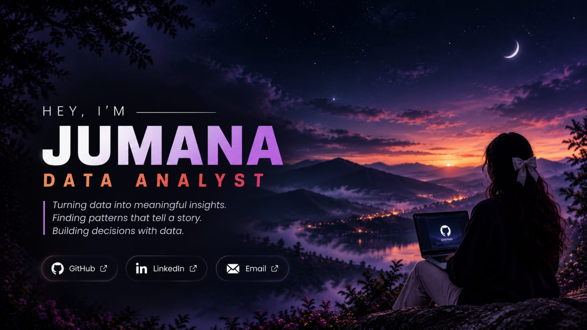

  

🛠️ Tech Stack

🐍 Python   •   🗄️ SQL

  

📊 Analytics & Visualization

  

📚 Python Libraries

---

✦ Projects

More projects coming soon...

---

🌙 Currently Learning

"Data Cleaning" → "SQL" → "Statistics" → "Power BI" → "Data Visualization"

---

✦ Let's Connect

  

<i>Learning • Analysing • Building</i>

 

