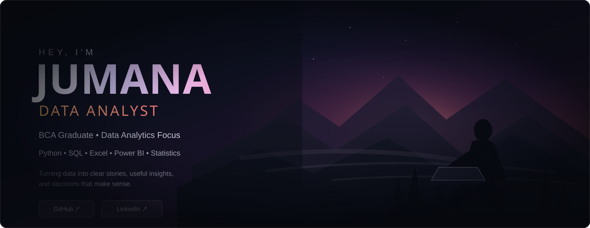

  

 

<h2 align="center">✦ TECH STACK ✦</h2>

  <b>Programming & Data Analysis</b>

  
  
  
  

  <b>Visualization & Business Intelligence</b>

  
  
  
  

  <b>Machine Learning & Tools</b>

  
  
  

 

---

<h2 align="center">✦ FEATURED PROJECT ✦</h2>

<h3 align="center">Customer Churn Analysis and Prediction</h3>

  An exploratory data analysis and machine learning project
  focused on understanding customer churn patterns and predicting
  customers who are likely to leave.

  <b>Tools:</b> Python • Pandas • NumPy • Matplotlib • Seaborn • Scikit-learn

  

 

<h2 align="center">✦ LET'S CONNECT ✦</h2>

  
  
  

 

  <i>Learning continuously. Exploring possibilities. Finding stories in data.</i>

